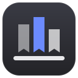
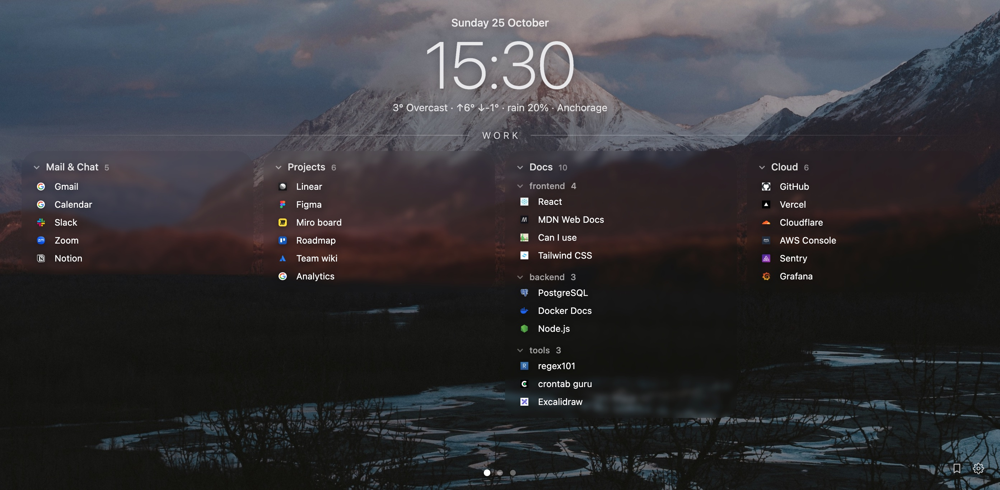

  

<h1 align="center">Shelf</h1>

  <b>A calm new tab page built from your bookmarks.</b> 
  Made for macOS: swipe left and right on the trackpad to move between your bookmark spaces.

  
  
  
  
  

  

## Features

- **Spaces you swipe.** Every top-level folder of the bookmark bar is a page of its own. Swipe sideways with two
  fingers on the trackpad - the page follows your fingers. Without a trackpad, use the dots at the bottom.
- **Folders as cards.** Subfolders nest inside their card and fold with a click. Rows shrink so a space always fits
  the screen.
- **Pick what shows.** Hide spaces, folders or single bookmarks; new bookmarks show up on their own.
- **Clock, weather, wallpaper.** Weather from [Open-Meteo](https://open-meteo.com), no API key. Set the same
  wallpaper as your Vivaldi theme background and the page lines up with the browser frame.

Tested on macOS with Vivaldi 8.2. It runs on other systems and Chromium browsers too, but it is designed around the
macOS trackpad and type.

## Install

1. Download `shelf-<version>.zip` from [Releases](https://github.com/pallad42/shelf-vivaldi/releases) and unzip it.
2. Open <kbd>vivaldi://extensions</kbd>, turn on <kbd>Developer mode</kbd>, click <kbd>Load unpacked</kbd> and pick
   the folder.
3. If Vivaldi still shows its Start Page: <kbd>Settings</kbd> → <kbd>Tabs</kbd> → <kbd>New Tab Page</kbd> →
   <kbd>Controlled by Extension</kbd>.

Settings (wallpaper, weather city, what shows) are behind the <kbd>⚙</kbd> button in the bottom right corner.
Everything is stored locally in the browser.

## License

MIT - see [LICENSE](LICENSE).
